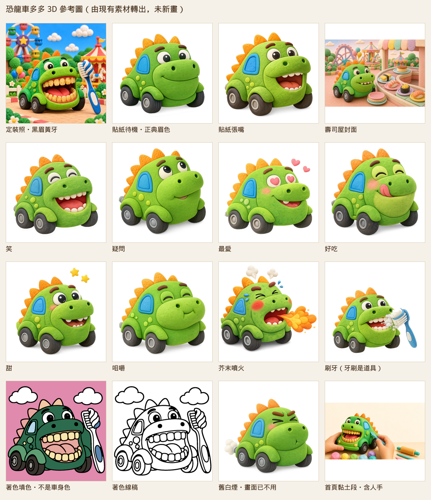

# 恐龍車多多 3D 建模需求單

狀態：草稿，給建模用。只整理儲存庫裡已經有的角色資料，沒有改網站程式、也沒有新畫角色。Kaiyi 在 2026-10-31 拍板的項目見下一節；還沒拍板的仍標「不確定」。

英文檔名用這次任務的 `dodo`。程式裡的 slug 是 `duo-duo`（`data/characters.ts`）。角色檔名用 `duo-duo.glb`，見第 8 節。

角色圖轉成 PNG 後放在 [`dodo-reference/`](dodo-reference/)。總覽：

## 已決定事項（2026-10-31）

Kaiyi 於 2026-10-31 決定。這些項目取代下文原先的「不確定」或「請決定」。

1. **預設造型用貼紙版**：暖棕眉、閉嘴淺笑。對 [`sticker-closed.png`](dodo-reference/sticker-closed.png)。眉毛維持暖棕，不改成定裝照的黑眉。
2. **另做一個張嘴黃牙 blendshape**，給故事用。牙色對定裝照 [`character-portrait.png`](dodo-reference/character-portrait.png) 的黃牙（取樣 `#F1B756`）。這一個表情用黃牙；貼紙 `sticker-open.png` 的米白牙不拿來當這個 blendshape。看得到牙的時候，上排 6 顆、下排 6 顆。牙齦用粉紅色。
3. **背刺 6 片，沿背脊正中線排成一列**。橘色圓角三角板，從頭頂排到背後。
4. **不做尾巴**。
5. **車尾做一根小排氣管**。外形對 [`sticker-puff.png`](dodo-reference/sticker-puff.png) 的小管子。白煙不是車身。
6. **另一側的藍車窗和圓點，照近側左右對稱**。近側圓點以待機貼紙上數到的 3 顆為準，另一側再鏡像 3 顆。
7. **做一扇可以開的車門**，給 ep-19。門開在近側：車頭朝畫面右時，看得到的那一側（與 [`sticker-closed.png`](dodo-reference/sticker-closed.png) 的藍窗同一側）。門形順著車身弧線，鉸鏈在前緣（靠車頭）。分鏡提示寫過沒有門板（`data/scenes/ep-19.json` 的 `NO door panels`）。3D 以這次決定為準。
8. **表情要做這些**：待機（閉合淺笑）、張嘴黃牙、大笑（`laugh`）、咬咬吃東西（`chew`）、好吃（`yum`）、愛心眼（`love`）、好奇張望（`look`）。大笑、咀嚼、好吃、愛心眼、好奇張望對同名貼紙。甜（`sweet`）和噴火（`fire`）的臉不用做進角色。
9. **牙刷、火焰、愛心、星星另外做道具 `.glb`**，不焊進車身。參考 `sticker-toothbrush.png`、`sticker-fire.png`、`sticker-love.png` 的愛心、`sticker-sweet.png` 的星星。每個道具檔三角面 ≤ 3,000、檔案 ≤ 500 KB。
10. **軸向與單位**：Y 向上、車頭朝 +Z、原點在四輪接地点的中心、地面 Y = 0。高度 1.0 = 1 公尺，從輪底量到最高的背刺。頭身比是大頭可愛比例，頭大約佔整車高度的一半（約 0.5 公尺）。
11. **角色檔 `duo-duo.glb`**：三角面合計 ≤ 8,000，檔案 2 MB 以內（含貼圖）。
12. **不做車頭燈，也不做尾燈。**
13. **肚子跟車身同色**。不另塗名冊寫的淺色肚，也不用定裝照那塊較亮的綠 `#93C729`。車身綠以貼紙待機中位 `#71AE2D` 為準。
14. **牙齦用粉紅色。** 沒有另給 hex。不要用定裝照嘴內紅 `#C73626` 或貼紙舌頭 `#D05B39` 當成牙齦。
15. **牙齒上下各 6 顆。** 各圖顆數不一致；著色提示的上限（上下各 ≤ 6）在這裡變成固定顆數。
16. **輪子用深灰輪胎配淺灰輪框。** 胎 `#3B3B3A`、輪框 `#AEAAA3`，取自貼紙待機。不用聖經用詞上的純黑，也不用定裝照更暗的 `#201306`。

## 1. 先看哪一套

兩套都在庫裡，眉色和牙齒不一樣。風格聖經已經寫明遊戲以哪一套為準。

| 優先 | 依據 | 用來對什麼 |
|------|------|------------|
| 1 | [`docs/STYLE-BIBLE.md`](../STYLE-BIBLE.md) §2.1，以及 `public/games/v2/dino-sushi/duoduo/` 黏土貼紙、`cover.webp` | 遊戲裡的多多：暖棕粗眉、四分之三、車頭朝右、沒有手腳 |
| 2 | `data/characters.json` 與 `public/characters/恐龍車多多.jpg` | 故事定裝照：黑眉、大張嘴、黃牙。聖經寫明這張不拿來改貼紙，也不重拍 |
| 3 | 故事分鏡 | 情節與情緒。角度仍多是四分之三，沒有背面或俯視的正交圖 |

聖經原文（§2.1，2026-10-13 拍板，2026-10-22 再確認眉毛）：

> 局內多多改用和封面同一套的黏土貼紙：綠車身、淺綠吻部、橘刺、暖棕粗眉、圓眼、藍側窗、四顆黑輪，沒有手腳。角度是四分之三、車頭朝右。
>
> 眉毛以暖棕粗眉為準。遊戲貼紙與封面都是暖棕粗眉；`public/characters/恐龍車多多.jpg` 定裝照是黑眉版，不拿來校正遊戲貼紙，也不重拍。

名冊對外觀的句子（`data/characters.json`）：

> a small green car body with a lighter green belly and a T-rex head, orange spikes along the head and back, thick black eyebrows, big round eyes on the head, a blue side window with no face on the glass, a wide open mouth with yellow teeth and a red tongue, four black wheels only. No arms, no hands, no limbs. The large blue toothbrush standing beside the car in the portrait is a prop, not part of the body.

名冊這句對的是定裝照（黑眉、黃牙）。和 §2.1 眉色不同。2026-10-31 已決定：預設造型跟貼紙（暖棕眉、閉嘴淺笑）；黃牙只做成故事用的張嘴 blendshape，眉仍是暖棕。

## 2. 角色個性與一句話

一句話取自 ep-9 的集數介紹（`data/apple-synced.json`，名冊 `firstSeen` 也是 ep-9）：

> 愛吃糖的恐龍車多多總是不刷牙，牙齒變得黃黃黏黏、嘴巴臭臭的。

他是一輛小綠恐龍車，不是人，也不是坐在車裡的恐龍。車種頁的說法是「恐龍加車車的想像組合」（`lib/vehicle-geo.ts`）。別名：多多、恐龍車、恐龍多多、恐龍車多多。

故事裡還寫過這些，都是情節，不是身體零件：

| 出處 | 寫了什麼 |
|------|----------|
| ep-9《刷牙故事｜恐龍車多多的大黃牙》 | 愛吃糖、不刷牙、牙齒黃黃黏黏 |
| ep-15《恐龍車多多洗手故事》 | 和朋友一起對付髒髒小怪獸 |
| ep-19《恐龍車多多闖禍了｜不能亂開車門》 | 沒看清楚就開門，害到老爺爺，自己也受傷，之後道歉 |
| ep-22 分鏡與字幕 | 上台講笑話；噗噗豬學他「平常害怕的樣子」，他低頭難過 |
| ep-32《換牙故事》 | 牙齒搖搖晃晃，原來是換牙 |
| ep-35 | 喜歡吃糖果，故事在講少吃糖、好好吃飯、刷牙 |

ep-17 有他出場，那集介紹的主軸是噗噗豬害怕。ep-31 字幕有他的名字，集數介紹的主軸不是他。

## 3. 造型特徵

下面每一項都標了出處。寫「不確定」的，圖或文字沒有給定，不要加。

### 車身

- 圓滾滾的小車，和霸王龍的頭是同一團黏土。頭就是車頭，不是車頂上再站一隻恐龍。出處：名冊、定裝照、貼紙。
- 四分之三側面時，車頭在畫面右側、車尾在左側。出處：風格聖經 §2.1；封面生圖腳本 `scripts/generate-dino-sushi-cover.ts` 也這樣寫。
- 沒有手、沒有腳、沒有手臂。出處：名冊、§2.1、各集分鏡提示（例如 ep-19 寫 `NO arms, NO hands`）。
- 名冊寫 lighter green belly（較淺的肚）。貼紙待機車身中位 `#71AE2D`、吻部 `#6EA72A`，幾乎同色。定裝照另有一塊較亮的綠 `#93C729`。2026-10-31 已決定：**肚子跟車身同色**，用貼紙車身綠，不另塗淺色肚。

### 恐龍特徵

- 背刺：橘色、圓角的三角板，從頭頂一路排到背後。出處：名冊 “orange spikes along the head and back”、§2.1「橘刺」、定裝照與全部貼紙。各圖片數不一致。2026-10-31 已決定做 **6 片，沿背脊正中線排成一列**。
- 尾巴：2026-10-31 已決定 **不做**。名冊和風格聖經都沒寫尾巴；未進庫的漫遊提示詞雖寫過 short tail，不採用。車尾是圓的綠色車身。
- 頭上有兩顆圓眼、兩道眉毛。遊戲與封面是暖棕粗眉；定裝照與首頁段圖是黑眉。以 §2.1 為準時用暖棕。
- 吻部兩側各有一個圓鼻孔。出處：貼紙與定裝照都看得到。
- 側窗：車身近側一塊藍色圓角窗，玻璃上沒有眼睛或嘴巴。出處：名冊 “a blue side window with no face on the glass”、§2.1「藍側窗」。2026-10-31 已決定 **另一側照近側左右對稱**，兩側各一扇，窗上都沒有臉。
- 近側車身有淺黃綠圓點。待機貼紙上數得出 3 顆，取樣約 `#A0D34A`。2026-10-31 已決定 **另一側照這 3 顆左右對稱**。
- 車門：2026-10-31 已決定 **做一扇可以開的車門**，給 ep-19。故事是「不能亂開車門」。分鏡提示寫過 `NO door panels`（`data/scenes/ep-19.json`），畫面上的藍色塊是窗，不是門板。門開在近側（車頭朝畫面右時看得到的那一側，與待機貼紙的藍窗同一側）。門形順車身弧線，鉸鏈在前緣。
- 排氣管：2026-10-31 已決定 **做一根小排氣管**，對 [`sticker-puff.png`](dodo-reference/sticker-puff.png) 車尾的小管子。風格聖經和名冊沒寫排氣管；以這次決定為準。白煙不建進車身。
- 車頭燈、尾燈：2026-10-31 已決定 **不做**。
- 牙刷：定裝照旁邊那支藍色大牙刷是道具，不是身體。出處：名冊最後一句。刷牙貼紙把牙刷放在嘴邊，也是道具。

### 輪子

- 四個輪子。出處：名冊 “four black wheels only”、§2.1「四顆黑輪」。
- 聖經的用詞是黑輪。貼紙取樣是深灰胎 `#3B3B3A`、淺灰輪框 `#AEAAA3`。定裝照胎色更暗，中位 `#201306`。2026-10-31 已決定用貼紙這組：**深灰輪胎 `#3B3B3A`、淺灰輪框 `#AEAAA3`**。
- 輪子上方有圓潤的綠色輪拱。出處：貼紙與定裝照。

### 和身體無關、不要建進車身的東西

- 人手、黏土工具：只出現在首頁 `segment-clay`。車沒有手。
- 糖果、遊樂園背景、壽司、愛心、星星、頭上的蒸氣、嘴裡噴出的火、白煙：都是該張圖的情節或表情效果。
- 消消樂棋子是另一種圖案：薰衣草紫車身 `#C9A8FF`、深色 `#8F6AD4`、角板 `#B18EF5`，頭頂三片角（`components/games/CandyMatchPieceArt.tsx`）。`docs/ART-AUDIT.md` 寫明淡紫恐龍車不是多多正典。
- 恐龍島圖 `public/adventures/zones/dino.png`（以及 `@2x`、`@3x`、webp）是一隻有長脖子、有腳的恐龍站在島上，不是這輛車。
- 向量版多多（`duoduo-art.tsx`）已刪。風格聖經寫：主人否決手繪 SVG 改版。不要照已刪的向量檔重建。

## 4. 配色

色碼從成圖像素取中位數（Pillow，不透明像素，用色相把車身、背刺、窗等分開）。黏土有明暗，所以這是中間調，不是設計 token。風格聖經只寫了「綠、淺綠吻部、橘刺、暖棕眉、藍側窗、黑輪」，沒有給角色 hex。`app/globals.css` 的 token 是網站 UI，不是這隻角色。

取樣日：依本次整理時的檔案。

### 預設配色：貼紙待機 `sticker-closed.png`（2026-10-31 已決定）

| 部位 | 中位色 | 備註 |
|------|--------|------|
| 車身 | `#71AE2D` | 肚子跟車身同色，已決定 |
| 吻部 | `#6EA72A` | 和車身幾乎相同 |
| 側邊圓點 | `#A0D34A` | 近側 3 顆 |
| 背刺 | `#F5A221` | |
| 側窗 | `#1892CC` | |
| 眉毛 | `#453225` | 這格取自張嘴貼紙，待機圖的眉和陰影黏在一起，單獨取樣不穩 |
| 輪胎 | `#3B3B3A` | 已決定用這組深灰，不用純黑 |
| 輪框 | `#AEAAA3` | 已決定的淺灰輪框 |
| 眼白 | `#F7F2E6` | |
| 瞳孔 | `#000000` | 最暗的像素是純黑 |

封面同一套造型，受場景光影響，車身 `#77A83A`、背刺 `#E88B3A`、側窗 `#49AFD1`、眉毛 `#503A1C`。

### 定裝照 `character-portrait.png`（黑眉、黃牙那張）

| 部位 | 中位色 |
|------|--------|
| 車身 | `#52A82D` |
| 較亮的一塊綠 | `#93C729` |
| 背刺 | `#F48924` |
| 側窗 | `#1C99DA` |
| 眉與瞳這一區 | `#0B1306`（近黑） |
| 牙齒 | `#F1B756` |
| 嘴內紅 | `#C73626` |
| 輪胎 | `#201306` |

### 貼紙張嘴時的嘴

| 部位 | 中位色 | 出處 |
|------|--------|------|
| 牙齒 | `#EADDBD` | `sticker-open.png`，偏米白 |
| 舌頭 | `#D05B39` | 同上 |

定裝照的牙齒是黃的 `#F1B756`。封面生圖提示詞寫 “white teeth”“No yellow teeth”。2026-10-31 已決定：待機臉是貼紙的閉嘴淺笑；故事另做張嘴黃牙 blendshape，牙色用 `#F1B756`，上下各 6 顆，牙齦粉紅色。貼紙張嘴的米白牙 `#EADDBD` 不用在那個 blendshape 上。

### 生圖提示詞裡的目標色（不是成圖取樣）

`scripts/generate-dino-sushi-cover.ts` 寫：車身 `#5CB83A`、淺吻 `#8FD14F`、背刺 `#F28A2E`。上線封面和貼紙的取樣都沒有落在這三個色上。吻部 `#8FD14F` 比較接近貼紙的側邊圓點 `#A0D34A`，不是吻部填色。

### 表情上才出現的顏色

| 效果 | 中位色 | 出處 |
|------|--------|------|
| 腮紅 | `#E16566` | `sticker-love.png` |
| 飄出的愛心 | `#FA8E92` | 同上 |

噴火、蒸氣、星星沒有另取一組「車身色」。它們不是車漆。

### 不要當成車漆的顏色

- 著色頁填色是平塗，車身約 `#2C6B4E`，底是粉紅。線稿本身沒有車漆。出處：`public/coloring/char-恐龍車多多/color.webp`，以及著色覆寫把這張的底設成 pink（`scripts/lib/coloring-reference-overrides.ts`）。
- 消消樂 `#C9A8FF` 見上一節。

## 5. 表情

遊戲貼紙的狀態寫在 `lib/games/dino-sushi/duoduo-sticker.tsx` 與風格聖經 §2.1。張嘴、咀嚼比表情優先。芥末的心情代碼仍是 `puff`，畫面改用噴火的 `fire`。`sticker-puff.webp` 留著，局內不用。

| 貼紙 | 參考圖 | 臉上有什麼 | 身體以外的東西 |
|------|--------|------------|----------------|
| `closed` 待機 | `sticker-closed.png` | 嘴閉上，淺淺的笑，眼睛睜開 | 無 |
| `open` 張嘴 | `sticker-open.png` | 嘴張開，米白牙，珊瑚紅舌頭 | 無 |
| `chew` 咀嚼 | `sticker-chew.png` | 眼睛彎起來，嘴抿著 | 無 |
| `laugh` 笑 | `sticker-laugh.png` | 眼睛閉成弧線，嘴張開笑 | 無 |
| `love` 最愛 | `sticker-love.png` | 愛心瞳孔、腮紅、微笑 | 兩顆粉紅心在頭旁，不是身體 |
| `yum` 好吃 | `sticker-yum.png` | 閉眼，舌頭舔到嘴邊，腮紅 | 無 |
| `sweet` 甜 | `sticker-sweet.png` | 睜眼微笑，看得到牙，腮紅 | 兩顆黃星在頭旁 |
| `look` 缺料、先不吃 | `sticker-look.png` | 眼睛往上看，小嘴微開 | 無 |
| `fire` 芥末 | `sticker-fire.png` | 眼睛擠起來，嘴張開，腮紅 | 頭上白蒸氣、汗滴，嘴前噴出橙黃火焰。聖經：頭上蒸氣＋嘴噴火 |
| `toothbrush` 刷牙 | `sticker-toothbrush.png` | 張嘴、有牙 | 藍色牙刷和白泡泡是道具 |
| `puff` 舊芥末 | `sticker-puff.png` | 眉頭皺、眼睛擠、嘴閉成一小條 | 車尾白煙。畫面已改用 `fire` |

貼紙沒有眨眼循環。聖經 §2.1：貼紙沒有眨眼。

故事定裝照是另一種臉：黑眉、嘴張得很大、黃牙、紅舌頭，旁邊一支牙刷。那是 ep-9「大黃牙」的牙與嘴。2026-10-31 已決定只借用黃牙做成張嘴 blendshape，眉仍用貼紙的暖棕，不整臉改成黑眉定裝。

### 3D 要做的表情（2026-10-31 已決定）

| 表情 | 做法 | 對哪張圖 |
|------|------|----------|
| 待機 | 預設形狀，閉合淺笑 | `sticker-closed.png` |
| 張嘴黃牙 | blendshape，給故事 | 嘴的開合可參考張嘴貼紙的開口。牙色 `#F1B756`，上下各 6 顆，牙齦粉紅色 |
| 大笑 | blendshape `laugh` | `sticker-laugh.png` |
| 咬咬吃東西 | blendshape `chew` | `sticker-chew.png` |
| 好吃 | blendshape `yum` | `sticker-yum.png` |
| 愛心眼 | blendshape `love` | `sticker-love.png`。飄出的愛心是道具，不是臉 |
| 好奇張望 | blendshape `look` | `sticker-look.png` |

甜（`sweet`）、噴火（`fire`）、刷牙（`toothbrush`）的臉不用做進角色。火焰、愛心、星星、牙刷是另外的道具 `.glb`。

著色線稿提示寫過牙齒上下各最多 6 顆（`plans/2026-10-05-coloring-lineart-prompts.md`）。封面提示詞寫 4 到 6 顆。定裝照的牙更多。2026-10-31 已決定：看得到牙的時候，**上排 6 顆、下排 6 顆**。牙齦粉紅色，沒有另給 hex。

## 6. 四個角度

庫裡沒有正面、純側面、背面、俯視的正交定裝。已核准的角色圖幾乎都是四分之三，車頭朝右（首頁群像裡他比較側、仍不是正交）。下面寫的是：這個角度應該看得到哪些已確認的零件；看不到的標不確定。

### 正面

- 霸王龍吻部朝前，臉在頭上，不在擋風玻璃上。
- 兩顆圓眼、兩道暖棕粗眉、兩個鼻孔。2026-10-31 已決定預設就是這張貼紙臉。
- 待機嘴是閉合淺笑。張嘴黃牙是另一個 blendshape，給故事，不是預設。
- 前輪兩顆，左右各一，圓輪拱。
- 兩側都有藍窗（已決定左右對稱）。正面會露出多少窗緣，仍不確定。
- 沒有手臂。不做車頭燈。
- 大頭約佔整車高度的一半。整車高 1 公尺。

### 側面

這一側是現有素材最完整的角度。對 [`sticker-closed.png`](dodo-reference/sticker-closed.png) 和 [`cover.png`](dodo-reference/cover.png)。

- 車頭在前、圓車尾在後。6 片背刺沿背脊正中線，從頭頂排到背後。
- 兩側各一塊藍色圓角窗，窗上沒有臉。近側對貼紙，另一側左右對稱。
- 兩側各 3 顆淺黃綠圓點，左右對稱。
- 四個輪子：近側兩顆看得比較完整，遠側兩顆從車身下緣露出來。
- 輪拱是圓的。
- 一扇可開的車門在近側（這一側），門形順車身弧線，鉸鏈在前緣。
- 車尾一根小排氣管，對 `sticker-puff.png`。不做尾燈。

### 背面

沒有核准的正背面圖。2026-10-31 已決定的背面零件：

- 車尾是圓的綠色車身。6 片背刺沿正中線收到後方。
- 後輪兩顆，深灰胎、淺灰輪框。
- 不做尾巴，也不做尾燈。
- 一根小排氣管，對 `sticker-puff.png` 的小管子。白煙不要做成車身。

### 俯視

沒有俯視圖。身體是圓潤的一整塊。2026-10-31 已決定：6 片背刺沿背脊正中線排成一列；兩側車窗與圓點左右對稱；頭大約佔整車高度的一半。整車從輪底到最高背刺是 1 公尺。

風格聖經 §7 原本把頭身比標成【未確認】。3D 以這次的大頭比例為準，不要再改回「沒量過所以自己猜」。

## 7. 風格要求

這次任務希望：低面數、圓潤玩具、給大約 3–7 歲、和網站插畫同一套。儲存庫裡已經寫死的是下面這些。三角面上限與檔案大小已在 2026-10-31 定為 ≤ 8,000 面、2 MB 以內，寫在第 8 節。聖經沒有「3–7 歲」這個區間。

風格聖經開頭：對象約 5 歲的孩子（操作）與家長（決定）。§2.1 又寫對象約 5 歲。聖經沒有寫「3–7 歲」這個區間。

§2 畫風表（2026-10-22 拍板）：故事插畫、Landing、角色、封面、多多與六位客人，是「暖色粉彩黏土照片／貼紙」。新圖只能落在聖經列的四套裡。3D 要看起來像這套黏土玩具：圓角、霧面、軟光，不要寫實鱗片，不要尖牙怪物。

黏土句子也在 `scripts/lib/illustrate-core.ts` 的 `CLAY_STYLE_PREFIX`：軟黏土／塑膠泥定格、圓潤、霧面、柔光、淡彩。那一段括號裡的粉彩 hex（`#f7a8c4` 等）是場景調色，不是多多的車漆。

視覺驗收 [`docs/VISUAL-ACCEPTANCE.md`](../VISUAL-ACCEPTANCE.md) B 節，和車身有關的：

- 光影：單一光源、柔和、低對比、沒有硬投影或反光；接地影短。
- 螢光、純飽和色 = 0。貼紙的綠和橘已經比 UI token 鮮，那是現有角色色；不要再加螢光邊。
- 圖內文字／數字 = 0（小紅賽車的「2」除外，多多身上沒有字）。出處：風格聖經 §4。

材質：霧面黏土，可以有很淺的壓痕和斑點，對貼紙的表面。不要高光塑膠，不要金屬車漆。

## 8. 技術規格

2026-10-31 已決定的列標「已決定」。其餘仍是建議，儲存庫裡沒有對應條文。

| 項目 | 規格 |
|------|------|
| 格式 | glTF 2.0。角色一個 `.glb`，道具分開 |
| 角色檔名 | `duo-duo.glb`（對齊 slug `duo-duo`） |
| 檔案大小 | 已決定：`duo-duo.glb` 2 MB 以內，含貼圖 |
| 三角面 | 已決定：車身、6 片背刺、五官、四輪、車門、排氣管合計 ≤ 8,000。圓潤用平滑法線，不要交細分後的高模 |
| 貼圖 | 建議：一張 baseColor，邊長 1024。斑點糊了才升到 2048。不要 4K。不要金屬度貼圖 |
| 粗糙度 | 建議：常數、霧面。不要鏡面窗 |
| 材質數量 | 建議：≤ 3。能用一張貼圖就用 1 個材質 |
| 原點 | 已決定：四輪接地点的中心，地面 Y = 0，Y 軸向上 |
| 朝向 | 已決定：車頭朝 +Z |
| 比例 | 已決定：輪底到最高背刺 = 1.0 = 1 公尺。頭大約佔這 1 公尺的一半 |
| 節點 | `body`、`spike_01`–`spike_06`（沿背脊正中線，由頭到尾）、`window_l`、`window_r`、`door`、`exhaust`、`eye_l`、`eye_r`、`brow_l`、`brow_r`、`wheel_fl`、`wheel_fr`、`wheel_rl`、`wheel_rr`。左右以車頭朝 +Z 為準。`door` 放在與 `sticker-closed.png` 藍窗同一側（車頭朝畫面右時的近側），鉸鏈在前緣 |
| 貼圖內容 | 只有車。不要烤進背景、人手、牙刷、糖果、火焰、愛心、星星、文字。不要畫車頭燈、尾燈 |
| 輪子配色 | 已決定：胎 `#3B3B3A`、輪框 `#AEAAA3` |
| 道具檔 | 已決定：牙刷、火焰、愛心、星星各一個 `.glb`，不放進 `duo-duo.glb`。每個三角面 ≤ 3,000、檔案 ≤ 500 KB。檔名建議 `prop-toothbrush.glb`、`prop-fire.glb`、`prop-heart.glb`、`prop-star.glb` |

表情用 blendshape，預設是待機閉嘴：

| blendshape | 表情 |
|------------|------|
| （預設，不另命名） | 待機，閉合淺笑 |
| `mouth_yellow` | 張嘴黃牙 |
| `mouth_laugh` | 大笑 |
| `mouth_chew` | 咬咬吃東西 |
| `face_yum` | 好吃 |
| `face_love` | 愛心眼 |
| `face_look` | 好奇張望 |

輪子做成獨立節點。這次不必做輪子轉動動畫。角色沒有手腳，建議不要為四肢做骨架。

## 9. 仍標成「不確定」的項目

2026-10-31 點名的造型都已決定，不放在這裡。下面這幾項還沒拍板，不要自己補完。

1. 正面會露出多少側窗窗緣：不確定。兩側都有窗、近側有門，已經決定。正面看過去窗緣露多少，沒有拍板。
2. 嘴唇內側的顏色：不確定。牙齦已決定用粉紅色，而且沒有指定 hex。嘴唇內側要不要跟牙齦同一粉紅，沒有說。
3. `public/stories/ep-31/01.jpg`、`public/stories/ep-35/01.jpg` 字幕有提到多多，這次沒有逐張打開，圖裡有沒有畫出他：不確定。ep-32 的分鏡摘要有多多，`characters` 陣列是空的，圖裡有沒有他：不確定。這幾張圖不影響這次的 3D 造型。

庫裡仍然沒有正面、純側面、背面、俯視的正交圖。那些角度的零件已經由已決定事項規定，不要因為沒有正交圖再改規格。

首頁黏土段圖裡的人手是場景，不是角色零件。手不要建成多多的手。

## 10. 需要 Kaiyi 決定的事項

原先列出的項目都已在 2026-10-31 決定，見文首「已決定事項（2026-10-31）」。這裡不再待決。

還沒決定的只剩第 9 節：正面窗緣露出多少、嘴唇內側色，以及 ep-31／ep-32／ep-35 有幾張圖沒有逐張核對。

## 11. 參考圖

下列 PNG 由現有點陣圖轉出或直接複製，沒有重畫。`contact-sheet.png` 是這批圖的縮圖拼貼。

| 參考圖 | 來源 | 建模時怎麼用 |
|--------|------|----------------|
| [`character-portrait.png`](dodo-reference/character-portrait.png) | `public/characters/恐龍車多多.jpg` | 只借黃牙色給張嘴 blendshape。眉不用這張的黑眉。牙刷是道具 |
| [`sticker-closed.png`](dodo-reference/sticker-closed.png) | `duoduo/sticker-closed.webp` | 預設造型：暖棕眉、閉嘴淺笑 |
| [`sticker-open.png`](dodo-reference/sticker-open.png) | `sticker-open.webp` | 張嘴 |
| [`sticker-chew.png`](dodo-reference/sticker-chew.png) | `sticker-chew.webp` | 咀嚼 |
| [`sticker-laugh.png`](dodo-reference/sticker-laugh.png) | `sticker-laugh.webp` | 笑 |
| [`sticker-love.png`](dodo-reference/sticker-love.png) | `sticker-love.webp` | 最愛。愛心是效果 |
| [`sticker-yum.png`](dodo-reference/sticker-yum.png) | `sticker-yum.webp` | 好吃 |
| [`sticker-sweet.png`](dodo-reference/sticker-sweet.png) | `sticker-sweet.webp` | 甜。星星是效果 |
| [`sticker-look.png`](dodo-reference/sticker-look.png) | `sticker-look.webp` | 疑問 |
| [`sticker-fire.png`](dodo-reference/sticker-fire.png) | `sticker-fire.webp` | 芥末。火與蒸氣是效果 |
| [`sticker-toothbrush.png`](dodo-reference/sticker-toothbrush.png) | `sticker-toothbrush.webp` | 刷牙。牙刷是道具 |
| [`sticker-puff.png`](dodo-reference/sticker-puff.png) | `sticker-puff.webp` | 小排氣管對這張的小管子。白煙不是車身。局內表情已改用噴火 |
| [`cover.png`](dodo-reference/cover.png) | `public/games/v2/dino-sushi/cover.webp` | 與貼紙同一套，有場景 |
| [`coloring-character-color.png`](dodo-reference/coloring-character-color.png) | `public/coloring/char-恐龍車多多/color.webp` | 著色填色，車漆不要照這張 |
| [`coloring-character-line.png`](dodo-reference/coloring-character-line.png) | `.../line.png` | 線稿剪影 |
| [`coloring-character-line-simple.png`](dodo-reference/coloring-character-line-simple.png) | `char-恐龍車多多-simple/line.png` | 與上一張只差 3 個像素，剪影相同 |
| [`coloring-scene-ep-9-05-color.png`](dodo-reference/coloring-scene-ep-9-05-color.png) | `public/coloring/scene-ep-9-05/color.webp` | ep-9 第 5 頁的著色參考 |
| [`coloring-scene-ep-9-05-line.png`](dodo-reference/coloring-scene-ep-9-05-line.png) | `scene-ep-9-05/line.png` | 同上線稿 |
| [`landing-segment-clay.png`](dodo-reference/landing-segment-clay.png) | `public/landing/segment-clay.jpg` | 跟著定裝照。畫面裡的人手不是角色 |
| [`landing-segment-clay-portrait.png`](dodo-reference/landing-segment-clay-portrait.png) | `segment-clay-portrait.jpg` | 直式，同一段 |
| [`landing-segment-stories.png`](dodo-reference/landing-segment-stories.png) | `segment-stories.jpg` | 四人合照，多多是其中一台，黑眉黃牙 |
| [`landing-segment-stories-portrait.png`](dodo-reference/landing-segment-stories-portrait.png) | `segment-stories-portrait.jpg` | 直式合照 |

`duoduo/sm/sticker-*.webp` 是畫面用的縮小副本，沒有再轉一份。

故事分鏡沒有整包轉進這個資料夾。角色欄寫了多多的有 63 張 jpg（約在第 12 節），角度仍是場景四分之三，沒有補上背面或俯視。整包轉 PNG 會把其他角色和背景一起放進來。

## 12. 素材路徑

### 角色本體圖

- `public/characters/恐龍車多多.jpg`
- `public/games/v2/dino-sushi/cover.webp`
- `public/games/v2/dino-sushi/duoduo/sticker-closed.webp`
- `public/games/v2/dino-sushi/duoduo/sticker-open.webp`
- `public/games/v2/dino-sushi/duoduo/sticker-chew.webp`
- `public/games/v2/dino-sushi/duoduo/sticker-laugh.webp`
- `public/games/v2/dino-sushi/duoduo/sticker-love.webp`
- `public/games/v2/dino-sushi/duoduo/sticker-yum.webp`
- `public/games/v2/dino-sushi/duoduo/sticker-sweet.webp`
- `public/games/v2/dino-sushi/duoduo/sticker-look.webp`
- `public/games/v2/dino-sushi/duoduo/sticker-fire.webp`
- `public/games/v2/dino-sushi/duoduo/sticker-toothbrush.webp`
- `public/games/v2/dino-sushi/duoduo/sticker-puff.webp`
- `public/games/v2/dino-sushi/duoduo/sm/sticker-closed.webp`
- `public/games/v2/dino-sushi/duoduo/sm/sticker-open.webp`
- `public/games/v2/dino-sushi/duoduo/sm/sticker-chew.webp`
- `public/games/v2/dino-sushi/duoduo/sm/sticker-laugh.webp`
- `public/games/v2/dino-sushi/duoduo/sm/sticker-love.webp`
- `public/games/v2/dino-sushi/duoduo/sm/sticker-yum.webp`
- `public/games/v2/dino-sushi/duoduo/sm/sticker-sweet.webp`
- `public/games/v2/dino-sushi/duoduo/sm/sticker-look.webp`
- `public/games/v2/dino-sushi/duoduo/sm/sticker-fire.webp`
- `public/games/v2/dino-sushi/duoduo/sm/sticker-toothbrush.webp`
- `public/coloring/char-恐龍車多多/color.webp`
- `public/coloring/char-恐龍車多多/line.png`
- `public/coloring/char-恐龍車多多-simple/line.png`
- `public/coloring/scene-ep-9-05/color.webp`
- `public/coloring/scene-ep-9-05/line.png`
- `public/landing/segment-clay.jpg`
- `public/landing/segment-clay.webp`
- `public/landing/segment-clay.avif`
- `public/landing/segment-clay-portrait.jpg`
- `public/landing/segment-clay-portrait.webp`
- `public/landing/segment-clay-portrait.avif`
- `public/landing/segment-stories.jpg`
- `public/landing/segment-stories.webp`
- `public/landing/segment-stories.avif`
- `public/landing/segment-stories-portrait.jpg`
- `public/landing/segment-stories-portrait.webp`
- `public/landing/segment-stories-portrait.avif`
- `public/landing/segment-stories-portrait-mobile.avif`

`sm/` 沒有 `sticker-puff` 的縮小檔。

### 角色設定與視覺規範

- `data/characters.json`（名冊條目「恐龍車多多」）
- `data/characters.ts`（slug `duo-duo`）
- `docs/STYLE-BIBLE.md`（§2.1）
- `docs/VISUAL-ACCEPTANCE.md`（全站視覺清單，沒有單獨的多多條目）
- `docs/ART-AUDIT.md`（眉毛以暖棕為準；淡紫棋子不是正典）
- `docs/episodes/ep-15-characters.md`
- `docs/proposals/2026-10-12-game-art-style.md`
- `docs/legal/IP-NOTES.md`（對外名稱，不是造型）
- `public/games/v2/dino-sushi/SOURCES.md`
- `lib/games/dino-sushi/duoduo-sticker.tsx`
- `lib/vehicle-geo.ts`（車種「恐龍車」一句話）
- `data/coloring-pages.ts`（`char-恐龍車多多`、`scene-ep-9-05`）
- `data/apple-synced.json`（ep-9、ep-15、ep-19、ep-32、ep-35 的介紹）
- `components/games/CandyMatchPieceArt.tsx`（`PieceDuoDuo`，不是正典）
- `lib/games/candy-match/levels.ts`（棋子色 `#c9a8ff`）
- `scripts/generate-dino-sushi-cover.ts`（提示詞裡的 hex 與「排氣管」）
- `scripts/generate-roamer-assets.ts`（`id: "duo-duo"` 的生圖提示，含 short tail；成品不在 `public/adventures/roamers/`）
- `scripts/generate-landing-art.ts`（`segment-clay`、`segment-stories` 的選角）
- `scripts/lib/coloring-reference-overrides.ts`（著色底色 pink）
- `plans/2026-10-05-coloring-lineart-prompts.md`（牙齒上下各 ≤6）

分鏡與字幕（造型提示在 scenes，對白在 subtitles）：

- `data/scenes/ep-9.json`
- `data/scenes/ep-15.json`
- `data/scenes/ep-17.json`
- `data/scenes/ep-19.json`
- `data/scenes/ep-22.json`
- `data/scenes/ep-32.json`（摘要提到多多，`characters` 為空）
- `data/subtitles/ep-9.json`
- `data/subtitles/ep-15.json`
- `data/subtitles/ep-17.json`
- `data/subtitles/ep-19.json`
- `data/subtitles/ep-22.json`
- `data/subtitles/ep-31.json`
- `data/subtitles/ep-32.json`
- `data/subtitles/ep-35.json`

### 不要當車身參考

- `public/adventures/zones/dino.png`
- `public/adventures/zones/dino.webp`
- `public/adventures/zones/dino@2x.png`
- `public/adventures/zones/dino@2x.webp`
- `public/adventures/zones/dino@3x.png`
- `public/adventures/zones/dino@3x.webp`

### 分鏡裡角色欄寫了「恐龍車多多」的 jpg

同一張另有 `.webp` 與 `.avif`。ep-9 的 `01.jpg` 是封面，`characters` 為空；這次看過，畫面上有他。下面從角色欄有名字的頁開始。

- `public/stories/ep-9/02.jpg`
- `public/stories/ep-9/03.jpg`
- `public/stories/ep-9/04.jpg`
- `public/stories/ep-9/05.jpg`
- `public/stories/ep-9/06.jpg`
- `public/stories/ep-9/07.jpg`
- `public/stories/ep-9/08.jpg`
- `public/stories/ep-9/09.jpg`
- `public/stories/ep-9/10.jpg`
- `public/stories/ep-9/11.jpg`
- `public/stories/ep-9/12.jpg`
- `public/stories/ep-9/13.jpg`
- `public/stories/ep-9/14.jpg`
- `public/stories/ep-9/15.jpg`
- `public/stories/ep-9/16.jpg`
- `public/stories/ep-9/17.jpg`
- `public/stories/ep-9/18.jpg`
- `public/stories/ep-9/19.jpg`
- `public/stories/ep-9/20.jpg`
- `public/stories/ep-9/21.jpg`
- `public/stories/ep-15/02.jpg`
- `public/stories/ep-15/03.jpg`
- `public/stories/ep-15/04.jpg`
- `public/stories/ep-15/05.jpg`
- `public/stories/ep-15/06.jpg`
- `public/stories/ep-15/11.jpg`
- `public/stories/ep-15/12.jpg`
- `public/stories/ep-15/13.jpg`
- `public/stories/ep-15/16.jpg`
- `public/stories/ep-15/18.jpg`
- `public/stories/ep-17/02.jpg`
- `public/stories/ep-17/03.jpg`
- `public/stories/ep-17/04.jpg`
- `public/stories/ep-17/05.jpg`
- `public/stories/ep-17/06.jpg`
- `public/stories/ep-17/07.jpg`
- `public/stories/ep-17/08.jpg`
- `public/stories/ep-17/09.jpg`
- `public/stories/ep-17/10.jpg`
- `public/stories/ep-17/11.jpg`
- `public/stories/ep-17/12.jpg`
- `public/stories/ep-17/13.jpg`
- `public/stories/ep-17/14.jpg`
- `public/stories/ep-17/15.jpg`
- `public/stories/ep-17/16.jpg`
- `public/stories/ep-19/06.jpg`
- `public/stories/ep-19/07.jpg`
- `public/stories/ep-19/08.jpg`
- `public/stories/ep-19/09.jpg`
- `public/stories/ep-19/10.jpg`
- `public/stories/ep-19/11.jpg`
- `public/stories/ep-19/12.jpg`
- `public/stories/ep-19/13.jpg`
- `public/stories/ep-19/17.jpg`
- `public/stories/ep-22/06.jpg`
- `public/stories/ep-22/07.jpg`
- `public/stories/ep-22/13.jpg`
- `public/stories/ep-22/14.jpg`
- `public/stories/ep-22/15.jpg`
- `public/stories/ep-22/18.jpg`
- `public/stories/ep-22/19.jpg`
- `public/stories/ep-22/20.jpg`
- `public/stories/ep-22/21.jpg`

另外有字幕、這次沒有當成造型依據的單頁：`public/stories/ep-31/01.jpg`、`public/stories/ep-32/01.jpg` 到 `09.jpg`、`public/stories/ep-35/01.jpg`。
