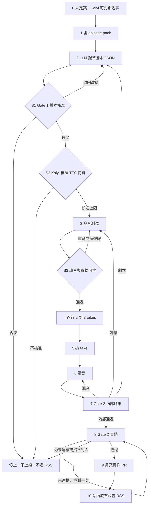

# 英文站內重創音訊 Pilot 流程（EP4）

> 搭配 [SPEC.md](./SPEC.md) v1.1。關卡表在 [templates/](./templates/)。  
> 日期：2026-10-17。對象：Kaiyi、AI assistant、cloud coding agent。

## 結論

這份流程從「組 episode pack」走到「站內發布」。現在只走到規格。腳本、TTS、音檔、網站接線都還沒開始。

每一個會花錢、會改故事、或會讓孩子聽到的步驟，都有停點。停點要 Kaiyi 用文字明確同意後才能繼續。Gate 1 過了還不能生成語音，中間還有一次花費核准。盲聽要找到 2–3 名英語環境的孩子，這是整條路徑裡最難排的一步；下面只列做法，不選一種。

中文原版 `public/stories/ep-4/audio.mp3` 與 RSS 維持現狀。英文版未過 Gate 2 之前，不對公開使用者顯示。

## 誰做什麼

| 角色 | 在這條流程裡 |
|---|---|
| Kaiyi | 未定案的決定、Gate 1 的最終拍板、花費核准、盲聽的同意與招募、發布與否 |
| AI assistant | 組 episode pack、貼 SPEC §7 prompt 起草腳本、整理審稿差異。不付費、不建音檔、不改 `data/`／`public/`／UI |
| cloud coding agent | 只在另案實作 PR 接網站（音檔路徑、資料側車、播放器、確認 feed 沒有英文 enclosure）。本流程文件不授權它改程式 |

## 停點一覽

| 停點 | 什麼時候 | 不過會怎樣 |
|---|---|---|
| S0 未定案 | 起草前，若 Kaiyi 要先鎖英文名或路徑 | 名字可以暫用 SPEC 的 PROPOSED 拼法繼續起草；Kaiyi 若說先鎖，就停在步驟 0 |
| S1 Gate 1 | 腳本進 TTS 之前 | 退回改稿，或否決並停止 |
| S2 花費 | Gate 1 通過之後、任何付費 TTS 之前（含少量發音測試） | 沒有這一句核准，不得呼叫付費語音 |
| S3 發音測試 | 全集逐行生成之前 | 專名讀錯或聲線分不開，就不全集生成 |
| S4 Gate 2 聽畢 | 混音之後 | 依問題退回腳本、聲線或混音 |
| S5 Gate 2 盲聽 | 對公開使用者顯示之前 | 未達標不得發布；招募不到人就停在這裡，不宣稱 pilot 通過 |
| S6 發布 | 盲聽通過之後 | 另案實作 PR。英文檔不得寫進 `story.audio`，不得進 RSS |

## 步驟

### 0. 未定案要不要先鎖

- **負責人：** Kaiyi。AI assistant 只把 [SPEC.md](./SPEC.md) 的 OD-1、OD-2、OD-3 列出來。
- **輸入：** SPEC 的〈未定案〉。
- **輸出：** Kaiyi 的文字選擇。兩種都合法：
  - 先鎖英文名（與 speaker id）再起草。
  - 允許草稿原樣使用 PROPOSED 拼法，Gate 1 再鎖。SPEC 的預設是這一種。
- **工具：** 無。
- **停點 S0：** Kaiyi 若要先鎖名字或先決定 `audio-en.mp3`／`data/en/` 是否採用，在回覆前不要進入步驟 2。路徑可以晚到步驟 9 再定，不擋起草。

### 1. 組 episode pack

- **負責人：** AI assistant。
- **輸入：** `data/stories.ts` 的 ep-4、`data/subtitles/ep-4.json`、`data/scenes/ep-4.json`、`data/characters.json` 相關角色、SPEC 的 B1–B15、§3.1、Glossary、OD-1 的暫用拼法。
- **輸出：** 一份給模型的 episode pack。放在 Kaiyi 的審稿工作區。**不 commit 進 `data/` 或 `public/`。**
- **工具：** 本機讀檔。不呼叫付費 API。
- **停點：** pack 和 SPEC 的時長、場景數、節拍對不上時停下來回報，不自行改節拍。

### 2. 起草英文腳本

- **負責人：** AI assistant。Kaiyi 決定用哪一個文字模型。
- **輸入：** SPEC §7 prompt 全文，加上步驟 1 的 pack。
- **輸出：** Part 1 人讀清單，以及 Part 2 JSON（每行含 `text` 與 `tts_text`）。檔名建議 `ep-4-script-v0.json`，與 Part 1 的 `ep-4-script-v0-review.md`，同樣先留在審稿工作區，不寫進 `data/en/`。
- **工具：** 文字 LLM。不產音訊。
- **停點：** 產出後停。不得把 JSON 送進 TTS。PROPOSED 名字若被模型改寫，退回重跑，不進入 Gate 1。

### 3. Gate 1 腳本核准

- **負責人：** Kaiyi 指定審稿者。至少 1 名熟悉原作的華語審稿者，加上 1 名幼兒英語審稿者。寫稿的人不得自己核可。Kaiyi 對英文名、站名、AI 標示文案有最終拍板。
- **輸入：** 步驟 2 的 Part 1 與 JSON、中文來源時間戳、[templates/gate-1-script-review.md](./templates/gate-1-script-review.md)。
- **輸出：** 填好的 Gate 1 表。結果是通過、退回修改、或否決。通過時附 script 版號（例如 `ep-4-script-v1.json`）與已鎖定的 Glossary 名稱表。
- **工具：** 表格。不需要 TTS。
- **停點 S1：** 清單有任何一項未勾，不得進步驟 4。否決則整條英文 pilot 停止，中文版不變。退回則回到步驟 2，版號遞增。

### 4. 花費核准

- **負責人：** Kaiyi。
- **輸入：** Gate 1 通過紀錄、定案 JSON 的逐行字元加總（送進 TTS 的是 `tts_text` 非空的那條，否則是 `text`）、當時 ElevenLabs 官方方案頁的試算、是否只做發音測試。
- **輸出：** 一段文字核准：供應商、用途（測試或全集）、金額上限、日期。SPEC 裡的估計數字不能代替這一段。
- **工具：** 供應商官網的價格頁。spec 階段不代查、不代買。
- **停點 S2：** 沒有這段核准，禁止任何付費生成，包括「先試幾句」。

### 5. 發音測試

- **負責人：** Kaiyi 聽。執行生成的人可以是 Kaiyi，或在 S2 核准範圍內的 AI assistant。cloud coding agent 不在這一步改網站。
- **輸入：** 鎖定後的專名、placeholder 換成真實 voice ID 的清單（這張清單不寫回 SPEC）、每角 1–2 句測試稿。
- **輸出：** 測試 take、發音詞典草稿（專名 → `tts_text` 讀法）。voice ID 記在生成清單，不記在規格書。
- **工具：** ElevenLabs 固定聲線。逐行，不整集。
- **停點 S3：** 專名讀錯，或鈴鈴／小紅／安安／旁白分不開，就停。先改 `tts_text` 或換聲線並再請 Kaiyi 聽。不得接著全集生成。

### 6. 逐行 TTS

- **負責人：** S2 核准的執行者。挑 take 的人要留下清單。
- **輸入：** Gate 1 定案 JSON、S3 通過的 voice 與 model／settings lock、發音詞典。
- **輸出：** 每行 2–3 個 take。檔名形狀 `S{scene}L{line}_{speaker}_take{n}`。目錄見 SPEC OD-2，**不要放進 `public/stories/ep-4/`**。
- **工具：** 與 S3 相同的 model 與參數。中途不換。
- **停點：** 禁止一次生成整集長檔再切。超出 S2 金額上限時停下來再問。

### 7. 挑 take

- **負責人：** Kaiyi，或 Kaiyi 指定、且會把未選 take 留到 Gate 2 之後的人。
- **輸入：** 步驟 6 的 takes。標準順序：發音正確、角色辨識度、情緒自然、語速。
- **輸出：** 選取清單（line_id、take 編號、voice ID、model、settings、日期）。
- **工具：** 聽覺檢查。無新的付費呼叫，除非某一行要重錄；重錄回到步驟 6，並確認仍在金額上限內。
- **停點：** 清單未完成不得混音。

### 8. 混音

- **負責人：** Kaiyi 或 Kaiyi 指定的人。
- **輸入：** 選取清單、腳本的 `sfx` 與 `pause_ms`、權利已經確認的音樂／音效。
- **輸出：** 一版混音母帶。最終網站檔名仍是 OD-2，在步驟 9 之前不覆蓋 `audio.mp3`。
- **工具：** 混音工具。中文原人聲（Bonbon、馬米原聲）不剪進來。權利不清的音樂改用已記錄來源的替代音效。
- **停點：** 人聲關鍵詞被音樂蓋住、擬聲與旁白疊到聽不清、寓意句前沒有停頓，就留在這一步重混。

### 9. 站內接線（另案，本流程不授權改碼）

- **負責人：** cloud coding agent 開**另一個**實作 PR。Kaiyi 先確認 OD-2 的路徑。
- **輸入：** 定案腳本 `text`（字幕用顯示拼法）、混音檔、鎖定的 toggle／AI 標示文案、SPEC §9.3。
- **輸出：** 實作 PR。預期會碰到 `public/stories/ep-4/` 的英文音檔、某種側車 JSON、播放器語言切換。`data/stories.ts` 的 `audio` 維持 `"audio.mp3"`，除非另有設計讓 feed 繼續只包中文檔。本文件不指定尚未決定的路徑。
- **工具：** 網站既有播放器。插圖沿用 `public/stories/ep-4/` 既有頁面，不外拷。畫面驗收用 [VISUAL-ACCEPTANCE.md](../VISUAL-ACCEPTANCE.md)。圖內文字規則見 [STYLE-BIBLE.md](../STYLE-BIBLE.md)。
- **停點：** Gate 2 尚未通過時，toggle 只放 staging／preview，不對公開使用者顯示。feed 出現英文 enclosure 則這步不算完成。

### 10. Gate 2 前半：內部聽畢

- **負責人：** 至少 1 名**沒有參加挑 take** 的人，加上 Kaiyi。
- **輸入：** 混音、定案腳本、staging（若步驟 9 已有 preview）、[templates/gate-2-listening-review.md](./templates/gate-2-listening-review.md) 的前半。
- **輸出：** 聽畢紀錄。不通過時寫明退回腳本、聲線或混音。
- **工具：** 播放器或母帶。另查 RSS：英文 URL 不得出現在 `app/feed.xml` 的 enclosure。
- **停點 S4：** 內部聽畢未過，不開始盲聽。網站項在實作 PR 還沒好時維持「未測」，不得勾成通過。

### 11. Gate 2 後半：盲聽

- **負責人：** Kaiyi（招募、家長同意、匿名紀錄）。AI assistant 可以幫忙整理答案表，不接觸可識別的兒童聲音檔。
- **輸入：** 只播英文音訊。可以看原站插圖。不給字幕當答案提示。四題與角色區分測驗見 SPEC §10 與 Gate 2 表。
- **輸出：** 每名孩子的年齡段與原答、角色區分結果、通過或未通過。不保存可識別童聲作其他用途。
- **工具：** 家長自己的播放環境，或 Kaiyi 在場播放。見下方招募做法。
- **停點 S5：** 每名孩子 Q1 與 Q4 要答對；Q2、Q3 至少一題答對、另一題提示一次後能理解；角色區分每名至少 2/3，且沒有一組角色被全體系統性混淆。未達標先修再測一次。第二次仍未達標，pilot 未通過。家長代答或現場翻譯給孩子聽，不算通過。

### 12. 發布

- **負責人：** Kaiyi 最後同意。cloud coding agent 只在實作 PR 已合併、且 Gate 2 兩半都通過之後，把 toggle 對公開使用者打開。那次打開若要改程式，仍走另一次 Kaiyi 點頭的變更，不在本文件的範圍裡自動發生。
- **輸入：** Gate 2 通過表、RSS 檢查、AI 標示在播放器看得見。
- **輸出：** 站內英文音訊可播。無英文 podcast enclosure。不對 Apple／Spotify／RSS 宣稱英文集。
- **工具：** 網站與 `/feed.xml` 人工對一次。
- **停點 S6：** 任一關否決，英文版不上線。中文原版不變。

通過之後若要再做三集，回到 SPEC §12。順序仍是未定案的建議（EP8 → EP5 → EP3），選集時重跑量化。

## 盲聽怎麼找到孩子

這一步比寫腳本、比生成語音都更卡排程：要 2–3 名、3–7 歲、平常有英語環境、沒先聽過中文版劇情說明、家長同意、而且回答時家長不提示。下面是可做的做法。**沒有選定。** Kaiyi 在步驟 11 開始前自己選，或把幾種併記在 Gate 2 表的「招募方式」欄。

1. **已經認識的家庭。** 朋友、親戚，孩子平常在英語環境。Kaiyi 或馬米當面說明，只記年齡段和答案。
2. **孩子本來就在的雙語或英語幼兒團體。** 須園方與每位家長同意。這是聽故事，不是研究計畫，不收集姓名。
3. **遠距。** 家長用自己的裝置播 staging 或母帶，把原答寫回來。說明裡寫清楚：先不要講劇情、不要把答案翻譯給孩子。
4. **先停在內部聽畢。** 人還沒找到時，pilot 停在步驟 10。內部聽畢通過不等於 Gate 2 通過。
5. **不採用的做法：** 公開廣告招募、付費兒童測試平台、把可識別的兒童聲音留下來做別的用途、請家長邊播邊翻譯。

招募方式本身要等 Kaiyi 寫進 Gate 2 表。本流程不代填。
