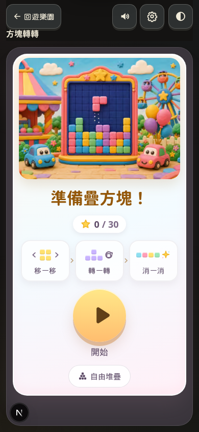
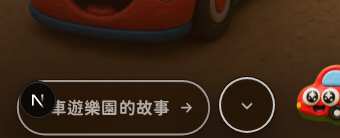

# 提案：按鈕陰影要不要統一

狀態：已決定：維持現狀。沒有改任何 `box-shadow`。

## 建議

**遊戲與著色保留短底邊，當作兒童按鈕的專用語彙。其餘一般頁面維持現在的 `--elev-*` 柔影，不要再改一輪。**

理由：一般內容頁（故事卡、Landing 分區 CTA）已經是柔影加 `--gloss`，不是厚底。硬底邊集中在三個地方，而且高度都不一樣，不適合成為全站一刀：

| 語彙 | 現況 | 建議 |
|------|------|------|
| 兒童遊戲／著色的短底邊 | 色票 `0 2px 0`；遊戲方鈕 `0 4px 0`；著色主鈕約 3–8px | 保留。明文登記即可，本輪風格聖經已登記現況 |
| 一般頁面 | `--elev-1/2/3`、`--shadow-sm/md` | 維持柔影 |
| 宇宙地圖木牌 | `MapControls`、熱點、島選擇列的 3–5px 底邊，常再加一層柔影 | 維持。那是地圖印刷物，不是網站按鈕 |

不建議把地圖木牌改成和故事卡一樣的柔影：木牌的底邊是「可以按的牌子」，拿掉之後和島上的裝飾更難分。也不建議把遊戲開始鈕的 8px 底邊削成 4px，那會改孩子已經在按的按鈕外形。

若以後只想收「既不是遊戲、也不是著色、也不是地圖」卻還有硬底邊的按鈕：目前 `app/` 與一般元件沒有這類宣告。剩下的都在下面清單裡。

## 影響範圍

搜尋 `0 Npx 0` 這類沒有模糊的底邊（2026-10-12）。實作統一時會碰到這些檔，本提案不動它們。

### 建議保留的兒童短底邊

- `components/coloring/ColoringPalette.module.css`（色票 `0 2px 0`）
- `components/coloring/ColoringCanvas.module.css`（換頁 `0 4px 0`、完成 `0 3px 0`）
- `components/coloring/ColoringToolbar.module.css`（家長閘門 `0 4px 0`）
- `components/coloring/ColoringPictureDialog.module.css`（`0 4px 0`）
- `components/coloring/ColoringReference.module.css`（`0 3px 0`）
- `components/coloring/ColoringCover.module.css`（`0 6px 0`、`0 8px 0`）
- `components/games/GamePageShell.module.css`（返回、日夜 `0 4px 0`）
- `components/games/GameChrome.module.css`（工具 `0 4px 0`；設定層另有 `0 8px 0`）
- `components/games/GameEndStation.module.css`、`GameLoadOverlay.module.css`
- `components/games/BlockDropTitle.module.css`、`BlockDropMap.module.css`（開始鈕約 5–8px）
- `components/games/CandyMatchView.module.css`、`CandyMatchMap.module.css`、`CandyMatchPlay.module.css`
- `components/games/DinoSushiView.module.css`、`DinoSushiKitchen.module.css`
- `components/games/ResultStars.module.css`（星星 `drop-shadow`，不是按鈕）
- `components/games/blockDropTheme.ts` 的 inline `primaryBtn`（`0 8px 0`）
- `lib/gamekit/react/tutorial-overlay.module.css`

### 建議維持的地圖木牌

- `components/universe/MapControls.module.css`
- `components/universe/IslandPickerStrip.module.css`
- `components/universe/HotspotLayer.module.css`
- `components/universe/ZoneSheet.module.css`
- `components/universe/HotspotModal.module.css`

### 一般頁面（已經是柔影，這份提案不改）

Landing 分區 CTA、故事卡使用 `--elev-*`／`--gloss`。見 `app/globals.css` 的 `--elev-1`（日間 `0 1px 2px` 加 `0 8px 24px`，有模糊）。

## 前後截圖

現況：著色封面「開始塗」的磚紅短底邊，以及方塊轉轉標題的開始鈕（厚底）。一般頁的 Landing 分區 CTA 則是深墨柔影。

若把兒童底邊改成柔影，開始鈕會變成下面這種（mock，沒有進站）：

不建議採用這張 mock 的做法。

## 如何回退

沒有改 CSS，所以沒有執行期可退。若以後真的把底邊改成 `var(--elev-1)`，回退就是還原那些 CSS module 與 `blockDropTheme.ts` 的 `boxShadow`，並更新被動到的視覺基線。不要改按鈕文案、顏色或遊戲規則。
