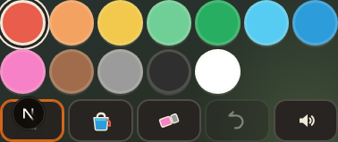
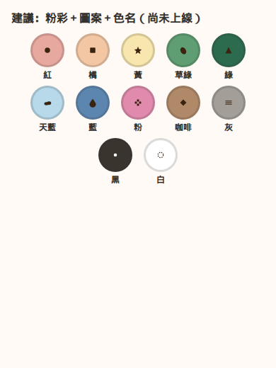

# 提案：著色 12 色改粉彩，並加上色名與圖案

狀態：已上線（2026-10-12，PR #206）。新色、圖案、色名一起在著色頁。

## 建議

建議做，但分成兩件，不要只換色：

1. **換色。** 現在的 12 色是蠟筆飽和色，和全站粉彩不是同一套。下面這組把彩度拉低，並把紅綠、橘與草綠、草綠與黃的亮度拉開。黑與白維持「塗黑」和「塗回紙白」，不改成米色。
2. **加圖案，色名放在圓形下面。** 約 5 歲不一定讀得出「紅色」。方塊轉轉已經在色塊裡放小符號（`blockDropTheme.ts`）。著色色票現在只有 `aria-label` 色名，看得見的人若分不出紅綠，讀屏也幫不上。建議每個色塊裡放一個固定小圖案，色名用 `--fs-meta` 放在圓形下方給家長看。不要把兩個字塞進 48px 的圓裡。

不建議做成家長開關才顯示。開關本身又是一個要找的控制；圖案應該一打開就在。

粉彩沒辦法讓每一對顏色的亮度比都 ≥3:1（三個都很淺時，亮度帶不夠分）。所以圖案是必要的，不是裝飾。下面標成仍低於 2:1 的對，就是圖案要分開的對。

## 建議色票

對比用 WCAG 2.x 相對亮度（sRGB），四捨五入到小數兩位。對白底低於 4.5:1 可以接受，因為這是作品顏色，不是介面文字。介面若要在色塊上寫色名，字要用 `--ink`，不要用色塊顏色當字色。

| id | 名稱 | 現況 | 對白底 | 建議 | 對白底 | 圖案 |
|----|------|------|--------|------|--------|------|
| red | 紅色 | `#E85D4C` | 3.44 | `#E7A8A0` | 2.00 | 實心圓 |
| orange | 橘色 | `#F4A261` | 2.06 | `#F4C7A4` | 1.55 | 方塊 |
| yellow | 黃色 | `#F2C94C` | 1.59 | `#F7E6AE` | 1.24 | 星星 |
| lime | 草綠 | `#6FCF97` | 1.90 | `#5E9E72` | 3.18 | 葉子 |
| green | 綠色 | `#27AE60` | 2.87 | `#2C6B4E` | 6.32 | 三角 |
| sky | 天空藍 | `#56CCF2` | 1.86 | `#B7D9EA` | 1.49 | 雲 |
| blue | 藍色 | `#2D9CDB` | 3.05 | `#5C86B0` | 3.82 | 水滴 |
| pink | 粉色 | `#F781C6` | 2.36 | `#E08AAD` | 2.50 | 花朵 |
| brown | 咖啡色 | `#A06C4C` | 4.43 | `#B08968` | 3.17 | 菱形 |
| gray | 灰色 | `#9B9B9B` | 2.78 | `#A39E98` | 2.66 | 橫線 |
| black | 黑色 | `#2F2F2F` | 13.39 | `#3A342E` | 12.28 | 小圓點 |
| white | 白色 | `#FFFFFF` | 1.00 | `#FFFFFF`（不改） | 1.00 | 虛線環 |

建議色的 RGBA（實作時要跟 hex 一起改）：紅 231,168,160；橘 244,199,164；黃 247,230,174；草綠 94,158,114；綠 44,107,78；天藍 183,217,234；藍 92,134,176；粉 224,138,173；咖啡 176,137,104；灰 163,158,152；黑 58,52,46；白 255,255,255。

### 容易混的對（亮度比，越高越好分）

| 對 | 現況 | 建議 | 說明 |
|----|------|------|------|
| 紅／綠 | 1.20 | **3.16** | 過了圖形 3:1。仍要留圖案，因為色相還是紅綠 |
| 橘／草綠 | 1.08 | 2.05 | 有拉開，還沒到 3:1 |
| 草綠／黃 | 1.20 | 2.55 | 有拉開，還沒到 3:1 |
| 天／藍 | 1.64 | 2.57 | |
| 紅／草綠 | 1.81 | 1.59 | 這對變近，靠圓形與葉子分開 |
| 粉／紅 | 1.46 | 1.25 | 變近，靠花朵與圓形分開 |
| 橘／黃 | 1.30 | 1.25 | 仍然近 |
| 粉／橘 | （都偏亮） | 1.61 | 靠花朵與方塊 |
| 灰／咖啡 | 1.59 | 1.19 | 變近，靠橫線與菱形 |
| 黑／白 | 13.39 | 12.28 | 仍然夠 |

## 前後對照

現況色票（著色頁控制列，間距改動前。390px 寬實測：色塊外緣約 51px、相鄰間距 4px，十二色排成一列，超出欄寬的部分這張圖沒有完整收進來。十二色色碼見上表與下方並排圖）：

建議色＋圖案＋色名（mock，不是上線畫面）：

並排色塊（不含頁面）：

## 影響範圍

會動到的程式與測試（實作時）：

- `lib/coloring/tools.ts` 的 `COLORING_PALETTE`（hex 與 rgba 要一起改）
- `lib/coloring/preferences.ts`、`components/coloring/ColoringCanvas.tsx` 預設色 `#e85d4c`
- `components/coloring/ColoringPalette.tsx`／`.module.css`：圓形下方加色名，高度會增加。畫布階段現在鎖在一屏裡，色盤變高會壓縮畫布
- `components/coloring/ColoringParentTools.tsx` 的小色點預覽
- 寫死舊色碼的測試與圖示：`ColoringPalette.test.tsx`、`reference-pick.test.ts`、`ColoringDoneSheet.tsx`、`ColoringToolbarIcons.tsx`、`e2e/coloring-enhancements.spec.ts`
- 已存在 IndexedDB 草稿：存的是像素，舊畫不會改色。選取色在載入時依「舊色→新色」對照表遷移（對不到就退回預設），不再留著舊 hex 對不上下一個色塊

不會改：線稿、遊戲玩法、全站品牌橘。

工作量：一個著色 UI PR。色票資料、色塊版面、圖案、測試與 390px 日夜截圖。不是重畫 12 張線稿。

## 如何回退

還原 `COLORING_PALETTE` 與色票元件即可。已塗進畫布的新顏色會留在那張草稿裡（像素已經寫入）；回退不會自動把舊畫塗回舊色。若要連草稿一起回到舊色，要把著色草稿世代 `COLORING_LINEART_REV` 加一，舊草稿會失效。沒有決定要清草稿之前，不要加世代。
